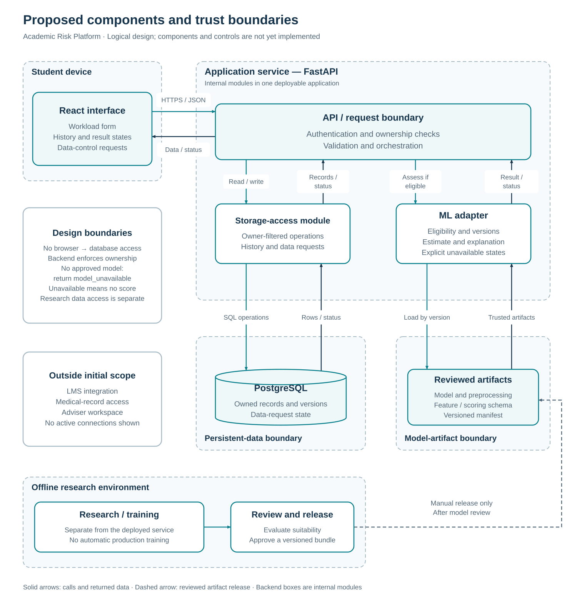

# Academic Risk Platform

**Development of a Platform for Early Prediction of the Risk of Academic Overload and Emotional Burnout in Students Using Explainable Machine Learning**

Astana IT University · Software Engineering · SE-2423  
Supervisor: **Akbota Rakym**

[Interactive prototype](https://aruzhanimm.github.io/academic-risk-platform/) · [Report PDF](reports/prob-period-1/SE-2423_Kartam_ProbPeriod1.pdf) · [Documentation](docs/README.md) · [User research](docs/02_user_interviews.md) · [Task board](https://academic-risk-platform.youtrack.cloud/agiles/204-1/218-1)

## About the project

Students often keep deadlines, assignments and study plans in several places. A due date alone may say little about the work still ahead. Academic Risk Platform explores how a personal workload history and understandable model explanations could help students recognise demanding periods and plan their work.

The aim is to develop a research prototype and assess whether appropriately collected student data can support early prediction of academic overload and emotional burnout. These are distinct research outcomes. The platform supports reflection and planning; it does not provide medical diagnoses or replace professional support.

## Explore the prototype

| Flow | What you can explore |
| --- | --- |
| Workload input | Enter a dated observation, review field guidance and cancel without saving. |
| Personal history | View observations, dates, units and empty or missing values. |
| Result availability | Distinguish an unavailable model from a separate insufficient-data example. |
| Data control | Preview export and deletion requests and their pending state. |

The current HTML, CSS and JavaScript prototype runs in browser memory and resets on refresh. It has no backend, authentication, persistent storage or predictive model, and sends no export or deletion request. The proposed application will add these capabilities only after their relevant data, research and software acceptance checks. The [UX specification](docs/08_ux_prototype.md) explains the four flows and their boundaries.

## What we learned from students

The [user-needs study](docs/02_user_interviews.md) brings together **five anonymised interview records and nine questionnaire submissions**. Students favoured brief input and personal access, with different preferences for update frequency. Some interview observations exposed confusion between an absent estimate and an absence of risk, making result wording a priority for further testing.

This is a small convenience sample. Survey and interview participation may overlap, while interview dates and the displayed prototype revision remain unconfirmed. The findings inform requirements; they do not establish successful usability testing or predictive performance. [Evidence summaries](docs/evidence/README.md) retain the counts and limitations.

## Proposed architecture



| Layer | Proposed choice |
| --- | --- |
| Student interface | React |
| Application service | Python with FastAPI |
| Data storage | PostgreSQL |
| API contract | REST with OpenAPI |
| Research and modelling | Python; libraries selected after the data audit |
| Collaboration | GitHub and YouTrack |

The [technology comparison](docs/05_technology_comparison.md), [architecture](docs/07_architecture.md) and [ADRs](docs/adr/README.md) explain the alternatives and decisions. Diagram [JSON sources and SVG exports](diagrams/README.md) remain editable.

Forecasting requires outcomes measured after prediction time, suitable repeated observations and validation separated by student and time. The [evaluation plan](docs/09_verification_evaluation.md) defines baselines, leakage checks and acceptance gates. Measurement, permitted data access, substantive team review and [supervisor feedback](docs/11_supervisor_feedback.md) remain open. Moodle integration and adviser access are later extensions with separate access requirements.

## Team

All three members study in **SE-2423**.

| Member | Responsibilities |
| --- | --- |
| [Aruzhan Kartam](https://github.com/aruzhanimm) | Research design, dataset assessment, modelling, explainability, evaluation and project coordination. |
| [Vitaliy Golubenko](https://github.com/checkybox) | Architecture, backend, database, APIs, model integration and technical testing. |
| [Saniya Yerzhan](https://github.com/ynsvrs) | Measurement, feature design, error analysis, user research, interface design and visualisation. |

The [task register](docs/10_project_management/task_register.md) links delivered work to issues and pull requests. [Milestones](docs/10_project_management/milestones.md), [risks](docs/10_project_management/risks.md) and the [YouTrack project](https://academic-risk-platform.youtrack.cloud/projects/ARP) track the remaining work.

## Run and edit locally

From the repository root, use Python 3:

```sh
python3 -m http.server 8000 --bind 127.0.0.1 --directory prototypes
```

Open [localhost:8000](http://localhost:8000). Stop with `Ctrl+C`; no installation or build step is needed. Use synthetic values only. Edit the files described in the [prototype guide](prototypes/README.md) and follow [CONTRIBUTING.md](CONTRIBUTING.md) when proposing changes.

The [research directory](research/README.md) contains literature, data assessments and protocols. The `src/` and `tests/` directories currently contain guides for future implementation.
