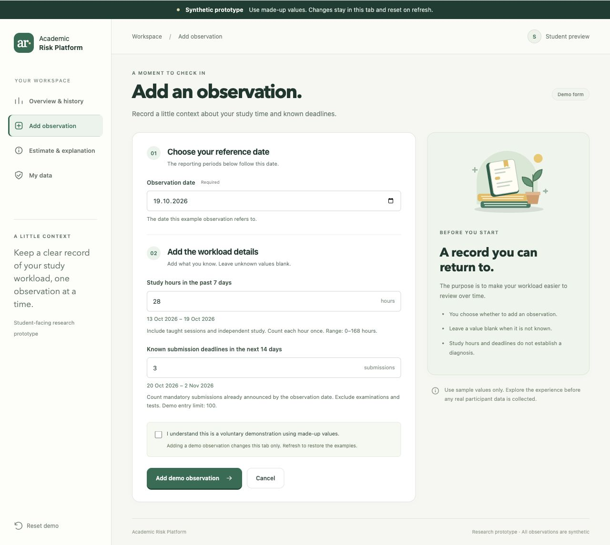

# 08. Interactive UX Prototype

The prototype specification covers the current interaction design and the user-research findings incorporated for the first submission.

The [interactive prototype](../prototypes/index.html) explores four student workflows: input, personal history, result availability, and data-control requests. All screens and seeded observations are synthetic. HTML, CSS, and JavaScript run locally without external dependencies, network requests, authentication, a backend, or a model. Changes exist only in browser memory; reloading restores the initial examples. The [prototype README](../prototypes/README.md) explains local use and editable sources.

This interaction prototype precedes the proposed React application. It follows the [technology direction](05_technology_comparison.md), [API state rules](adr/003-http-api-contract.md), and [interface decision](adr/004-student-interface.md).

## Screens and information hierarchy

Demo labels, visible periods/units, and textual unavailable states distinguish sample observations from computed estimates.

| View | Purpose and capture |
| --- | --- |
| History | Dated observations, study-hour chart, filtering, and empty-state preview. [Desktop capture](../prototypes/exports/history.jpg). |
| Result availability | Default missing-model state and a separate insufficient-input example. [Desktop capture](../prototypes/exports/explanation.jpg). |
| Data control | Request type/scope, confirmation, and simulated pending status. [Desktop capture](../prototypes/exports/data_control.jpg). |
| Narrow screen | Responsive navigation and readable forms. [Mobile capture](../prototypes/exports/mobile.jpg). |

Captures document appearance, not usability-test results.

## Input meaning and research boundaries

The [feature register](../research/feature_operationalization.md) contains candidate factors, not an approved questionnaire. The prototype explores a small subset.

| Input | Meaning and limitation |
| --- | --- |
| Observation date | Required context for the demo record. It does not establish when a real service received information or a historical prediction was made. |
| Study hours | Optional hours during the seven days ending on the observation date, including taught and independent study without double-counting. Fractions are allowed. The 0–168 demo range follows candidate F-01; it is not a burnout threshold. |
| Known upcoming deadlines | Optional non-negative whole-number count for the next 14 days, beginning the day after the observation date, aligned with candidate F-02. Only already-announced deadlines would be eligible at prediction time. The maximum of 100 is a demo entry limit, not a validated cutoff. |

Blank numeric inputs become missing values (`null`), displayed as “Not provided”; zero remains a valid numeric value. These rules do not establish a future model's eligibility requirements. Wording, windows, and bounds require review before real collection. The [literature review](03_literature_review.md) distinguishes workload, overload, burnout, and other outcomes. A synthetic weekly chart shows entered study hours, not measured burnout or a risk trend. No suitable dataset, target, horizon, or evaluated forecasting model is established by this prototype.

## Intended flows and alternatives

| Use case | Main prototype flow | Alternative and interpretation |
| --- | --- | --- |
| **UC-01: Input** | Read the notice, acknowledge the demo context, enter sample values, and add a demo observation to memory. | Without acknowledgement or with invalid values, show identifiable validation errors. Leaving the screen without submission adds no observation. Reloading removes session additions. |
| **UC-02: Own history** | View dated synthetic records with hours/counts; filter the displayed history and inspect the study-hour chart. | Preview an empty history, then return to populated examples. Filtering or previewing emptiness is not deletion. The single demo identity does not demonstrate ownership enforcement. |
| **UC-03: Estimate/explanation** | Open the result view and see `model_unavailable`, with no number or feature contributions. | Select the explicitly labelled `insufficient_data` preview to inspect alternative wording. This is an independent scenario illustration, not a model's assessment of the entered values. |
| **UC-04: Data control** | Select export/deletion, inspect the proposed scope, confirm, and create a simulated pending request. | Missing confirmation prevents the preview. Pending never means completed: no file is exported, no records are deleted, and no request is sent to a service. |

In a future service, model availability is checked before model-specific sufficiency. An available prediction requires successful inference; inference failure is a separate operation error. If only explanation generation fails, a valid prediction can remain available with an unavailable explanation. These behaviours remain outside this prototype's result calculation capability.

## Requirement and state coverage

These IDs preserve project traceability; prototype coverage does not establish requirement acceptance.

| Requirement | Prototype coverage | Remaining implementation |
| --- | --- | --- |
| FR-001: information and voluntary input | Visible demo notice and acknowledgement. | Record the applicable notice version for real observations. |
| FR-002: validated saving | Browser validation and simulated memory save. | Authoritative server validation, transaction integrity, and retry deduplication. |
| FR-003: own chronological history | Synthetic history, units, filter, chart, and empty preview. | Owner-filtered queries, stable pagination, and persistent records. |
| FR-004: computed result and explanation | No computed result or explanation is claimed. | Evaluated model, snapshot/version context, interpretation, and explanation behaviour. |
| FR-005: unavailable states and failures | Default `model_unavailable`; separate `insufficient_data` preview. | Execution-error paths, available result, and explanation-failure handling. |
| FR-006: export/deletion requests | Scope, confirmation, and simulated pending preview. | Owner checks, processing, completion, download expiry, deletion scope, and backups. |

NFR-004 concerns accessibility and understanding: labels, keyboard order, visible focus, textual states, and narrow-screen layout need inspection and actual walkthroughs. NFR-001 ownership, NFR-002 the personal-data lifecycle, NFR-003 temporal reproducibility, NFR-005 server performance, and NFR-006 deployment security/failure handling remain implementation requirements. Local responsiveness and a screenshot cannot establish them.

## User feedback and further walkthrough checks

The [user research synthesis](02_user_interviews.md) combines nine questionnaire submissions with five anonymised interview records. The notes report finding recent observations and data controls, but also show uncertainty about missing estimates. Two records initially associate an absent estimate with no risk; several explanations refer to insufficient data without identifying which result state was displayed. Exact session dates and the prototype revision shown remain unconfirmed.

These observations support testing the distinction between `model_unavailable`, `insufficient_data` and low risk. They do not establish five successful comprehension tasks. The history chart represents sample study hours, not an overload score. Participants reportedly distinguished pending deletion from completion, but the notes do not establish whether everyone understood that a prototype request is only a preview. The [detailed synthesis](evidence/interview_synthesis.md) links these issues to FR-003, FR-005, FR-006 and NFR-004.

The following tasks remain the procedure for a more controlled follow-up.

Use synthetic examples and let participants decline or stop. Ask participants to perform tasks before explaining controls; record what happened separately from interpretations.

1. Identify the demo's purpose and whether anything is sent or saved permanently.
2. Try an invalid study-hour value, interpret the error, correct it, and add a demo observation.
3. Find the newest observation, explain its units, use the filter, and distinguish an empty preview from deletion.
4. Explain what the unavailable-model screen means; inspect the insufficient-data example without interpreting either as zero risk.
5. Preview a deletion request and explain whether deletion has occurred.
6. Navigate by keyboard and inspect a narrow viewport; identify any action or text that becomes difficult to use.

The record below is for further sessions. Existing feedback is reported separately above; no standardised completion rate or accessibility result is claimed. Keep identifying information out of the repository.

| Evidence field | Value to record after the session |
| --- | --- |
| Session date; anonymous participant code; voluntary participation | — |
| Prototype revision; browser; viewport; input method | — |
| Task; expected behaviour; observed behaviour; help provided | — |
| Participant's interpretation; quotation permission if relevant | — |
| Issue, severity, affected FR/NFR, and proposed change | — |
| Follow-up decision, actual reviewer, and verification evidence | — |

Reconcile the prototype and requirement/architecture drafts before implementation; record actual evidence for later changes.

## Result wording revision

The result screen now explicitly states that no prediction model is connected, that adding observations will not enable a prediction, and that an unavailable result is not a low or zero risk result. This change follows the interpretation issues in the interview notes. [Browser verification](evidence/prototype_checks.md) checks the revised demonstration; a participant retest is still needed.
