# 1 Project Proposal

## Problem and purpose

We propose a platform that helps students review their academic workload and understand what a future risk estimate can and cannot tell them. A short record of study hours and known deadlines could make changes in workload easier to notice. A nine-response questionnaire and five interview records provide initial user evidence. Further walkthroughs and measurement review will guide the final input fields.

The project concerns academic overload and emotional burnout, which need separate definitions. A deadline count is a workload indicator; it is not a burnout measurement. The platform is intended for awareness and planning, with no diagnostic function or automatic sharing of personal records.

This report presents user evidence, research, requirements, architecture, an interactive prototype with sample data, and the evaluation and management plans for the first probation period. The proposed application uses React, FastAPI, PostgreSQL and a JSON API described with OpenAPI. Backend services, authenticated storage and a trained model remain future implementation work.

## Aim and objectives

Our aim is to develop a student application and investigate whether earlier observations can predict a clearly defined future outcome. The project has five objectives:

1. Identify useful information and acceptable input effort through student discussions and observed use of the prototype.
2. Review measurement, prediction and explanation research, and compare existing products and technology choices.
3. Agree on an outcome, instrument, prediction horizon and permitted data source before training.
4. Implement validated input, personal history, explicit result states and export or deletion requests.
5. Evaluate software behaviour, predictive performance and user understanding separately, using reproducible procedures.

## Scope and feasibility

The initial user is a student viewing their own records. Four workflows define the scope: add an observation, review history, inspect a result, and manage personal data. An adviser workspace, Moodle or calendar imports, reminders and links to university support services are possible later extensions. They need their own requirements and access arrangements.

The [dataset audit](../../research/dataset_audit.md) and [feature register](../../research/feature_operationalization.md) have not confirmed a suitable accessible longitudinal burnout dataset. Before forecasting is possible, we need repeated observations linked to the same students and an independently measured later outcome. The instrument, language, scoring and horizon are still open. The supervisor requires an evidence-based feasibility decision and a narrower fallback if future prediction cannot be supported.

Until an evaluated model is available, the interface shows `model_unavailable` and no numerical risk score. Sample records let us review the interaction without presenting them as participant data or model results.

# 2 User Evidence and Interviews

## Purpose and method

We examined how students organise deadlines, estimate the work ahead and decide what information to share. The evidence consists of nine questionnaire submissions and five anonymised interview records, S01 to S05. Students were recruited through the team's existing contacts, so this is a small convenience sample.

The [Russian questionnaire](https://forms.gle/LZZL73VuXMRriJzs7) was published on 23 October 2026. Its summary showed nine submissions when checked on 24 October. All nine included the participation acknowledgement. Eight substantive questions were optional; the form did not request names, email addresses, groups, grades or medical information. Because identities were not collected, we cannot verify that every submission represents a different person or identify overlap with the interviews. The two sources are therefore analysed separately.

Vitaliy Golubenko conducted the five discussions. The records indicate permission to retain anonymised notes and cover face-to-face, voice and text conversations. We use paraphrases throughout, including S03, who did not permit direct quotation. Exact session dates and the prototype revision shown have not been confirmed, so no chronology or revision-specific completion rate is inferred from the notes. The [evidence register](../../docs/evidence/README.md) links the instrument summary, aggregate counts and interview synthesis.

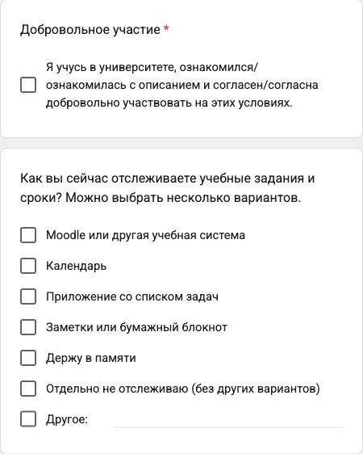

## Questionnaire findings

The following counts use nine submissions as the denominator. Multiple selections were permitted for tools and acceptable inputs, so those counts do not add up to nine.

| Topic | Recorded result | Implication for the design |
| --- | --- | --- |
| Current tools | 6 selected Moodle or another learning system; 4 rely on memory; 3 use a task list. | Students already have ways to obtain deadlines. The platform should help interpret workload and avoid requiring unnecessary re-entry. |
| Difficulty seeing upcoming tasks and deadlines | 4 selected often, 2 sometimes, 1 rarely and 2 never. | The need varies. A useful design should support students who struggle without assuming that every student needs another planner. |
| Acceptable input | 7 selected tasks and deadlines; 4 study time; 4 a personal workload rating. | Keep entry brief and explain why each field is useful. These selections do not validate a burnout questionnaire. |
| Preferred entry frequency | 3 selected daily, 3 several times weekly and 3 weekly. | A compulsory daily routine would not fit all stated preferences. |

Seven submissions contained text for current planning, missing information and university support; eight contained text for visibility. Some entries were only punctuation or otherwise non-substantive. These counts indicate completion of a field, not the number of meaningful themes. We do not quote or infer preferences from text that was not substantively coded. The full closed-question counts are in the [survey results](../../docs/evidence/survey_results.md).

## Interview findings

Four records describe a recent planning difficulty. S04 reports a method that works, which is an important counterexample to a universal need for the proposed application.

| Record | Experience and requested information | Input and visibility preferences |
| --- | --- | --- |
| S01 | Tasks are spread across messages and a learning portal. Several deadlines coincided; task effort was harder to judge than the due date. | Very short entries; personal access only. |
| S02 | Calendar entries did not show the amount of study work needed when commitments overlapped. Earlier notice of busy periods would help. | Brief updates several times a week; no identifiable institutional access. |
| S03 | An incorrectly remembered Moodle deadline led to a missed task. A clear overview was preferred to detailed manual planning. | Minimal entry; a limited status could be shared with an adviser only for useful support. |
| S04 | Breaking work into stages already supported planning. Estimated task difficulty was still useful; frequent reminders were unwelcome. | A short weekly update; personal access only. |
| S05 | A shared deadline record was not updated after dates changed. The participant wanted current information from the learning system. | One or two actions per update; detailed activity remains private. |

All five records favour low input effort, but the preferred frequency differs. Two favour strictly personal records, two would consider aggregate institutional information, and one would consider a limited adviser view. These views support personal access as the default. They do not establish consent to collect real records for a pilot or to share them with the university.

## Prototype observations

The notes describe finding recent observations, interpreting an unavailable forecast and viewing a deletion request. They suggest that navigation was generally understandable, but the result screen needs closer testing. S01 and S03 initially interpreted the absence of an estimate as an absence of risk. Several explanations then referred to insufficient data or ongoing statistics collection. The notes do not establish whether the default `model_unavailable` screen or the separate `insufficient_data` example was displayed.

Those states mean different things. The current prototype has no enabled model and produces no numerical risk score. One record mentions a coloured overload indicator, which the published prototype does not provide. We retain this as an unresolved interpretation rather than evidence of a working forecast. The records suggest that participants did not regard deletion as completed, but they do not establish that everyone understood that the prototype sends no request at all. These observations are not a standardised usability score or five successful task completions.

## Effect on requirements and next checks

| Evidence | Requirement or scope decision | Next check |
| --- | --- | --- |
| Brief input is preferred; frequency varies across the questionnaire and interviews. | FR-002 and NFR-004: retain a short form and avoid an unexplained daily obligation. | Observe an entry task without assistance and ask which fields felt unnecessary. |
| Deadlines alone may conceal task effort, while S04 already has a useful planning method. | FR-003: show dates and units clearly; do not label a workload chart as burnout or risk. | Ask participants to explain a history entry and what the chart measures. |
| Missing estimates were confused with low risk or insufficient data. | FR-005 and NFR-004: preserve distinct model and input states, without a score. | Show each state separately, record the displayed state, and ask for an unprompted explanation. |
| Visibility preferences differ and personal access is repeatedly preferred. | NFR-001 and NFR-002: keep owner access and data minimisation as the baseline. | Review sharing scenarios separately before considering adviser access. |
| Participants distinguished pending deletion from completion, but simulation awareness was unclear. | FR-006: distinguish a preview, a submitted request and a completed operation. | Ask whether anything was sent, whether records remain and what confirmation would mean. |
| S02 and S05 raised synchronisation and duplicate entry. | Keep Moodle/calendar imports as a later extension. | Check actual access arrangements and changing-deadline cases before adding an integration requirement. |

These findings guide workflow refinement; they do not establish burnout prevalence, instrument validity or predictive accuracy.

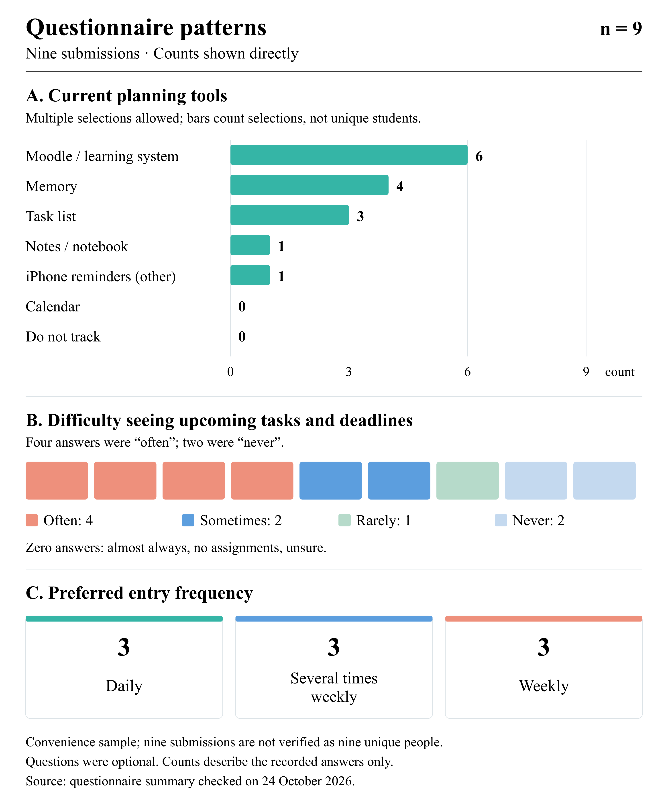

[Editable chart](../../diagrams/report/survey-summary.svg) · [Aggregate chart data](../../diagrams/report/survey-summary.json).

The revised result wording has passed the recorded [browser checks](../../docs/evidence/prototype_checks.md); participant understanding of the revision remains to be retested.

# 3 Literature Review

## Review scope

The core review uses 13 unique sources: ten scientific publications and three official technical documents. The scientific sources comprise nine journal articles and one conference paper. The search was thematic rather than systematic. Older papers are included where they establish relevant methods or datasets; the review is not restricted to the latest five years.

The [editable research map](../../diagrams/report/research-map.svg), [search log](../../research/search_log.md), [measurement evidence cards](../../research/contributions/measurement_review.md) and [ML evidence cards](../../research/contributions/ml_validation_review.md) record the reading behind this synthesis. The [bibliography](../../research/bibliography.md) provides reading locations and access notes. Instrument reuse and translation permissions require a separate check. Numerical findings below belong to the cited studies. They are not results from our project.

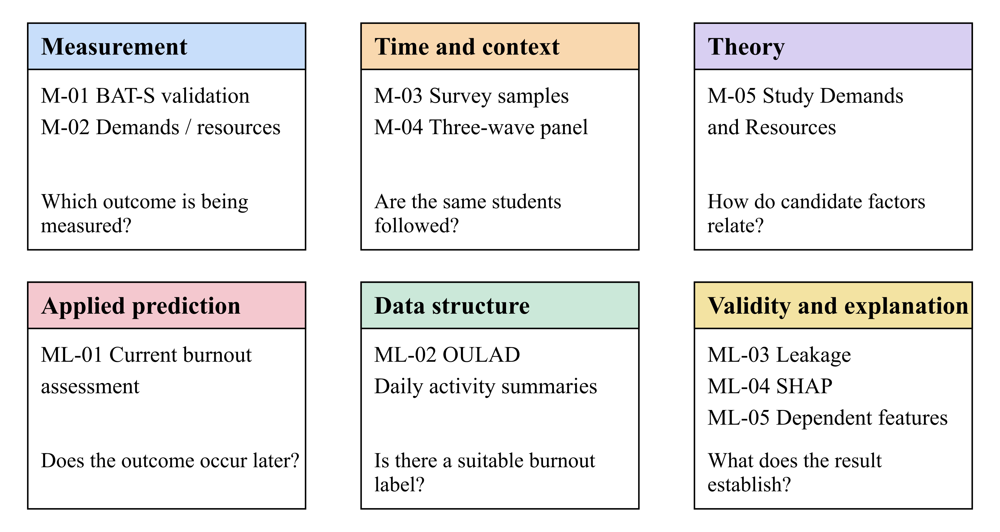

## Structured comparison of publications

| Study | Design and data | Relevance and limitation |
| --- | --- | --- |
| M-01 | BAT-S validation; 461 Chilean undergraduates; one survey. | Instrument structure and reliability; no forecasting test or local language validation. |
| M-02 | Demands, resources and MBI-SS; 743 Hungarian students; CFA and SEM. | Distinct factor groups; within sample associations, without temporal validation. |
| M-03 | Three Helsinki survey samples of 1,501, 1,526 and 1,685 students. | Calendar and context matter; individual longitudinal linkage is not established. |
| M-04 | Three wave panel of 392 German students; six month intervals. | Earlier pressure and later exhaustion; no independent predictive test set. |
| M-05 | Theoretical review of Study Demands-Resources. | Construct map and changing states; no new dataset or model benchmark. |
| ML-01 | Current burnout in 442 Chinese nursing students; random forest used a random 70/30 split. | Applied ML example; no future label, temporal validation or confirmed transfer. |
| ML-02 | OULAD data descriptor; academic registrations and dated daily activity summaries. | Temporal schema example; no burnout outcome and no project raw data audit. |
| ML-03 | Leakage taxonomy, evidence review and a reanalysis case. | Supports separation and availability checks; not a student prediction study. |
| ML-04 | SHAP theory and algorithmic examples. | Explains model output; local accuracy is not predictive accuracy or causality. |
| ML-05 | Dependent feature simulations and a mortgage example. | Attribution assumptions matter; real data have no known true attributions. |

## Measurement and time

**M-01. Carmona-Halty et al. (2024).** The authors studied BAT-S in 461 Chilean undergraduates using confirmatory factor analysis and structural equation modelling. The 12 item instrument covers four dimensions. Model M4 had CFI 0.975 and RMSEA 0.073; overall omega was 0.874, compared with 0.689 for mental distance. The sample was not representative and the study was cross sectional. It offers a candidate instrument, but neither confirms its suitability in Kazakhstan nor tests forecasting.

**M-02. Jagodics and Szabó (2023).** A survey of 743 Hungarian students examined study demands, resources and MBI-SS burnout scores. Structural equation models reported within sample R² values of 0.664 for exhaustion, 0.721 for cynicism and 0.636 for reduced accomplishment. Convenience sampling, variable selection and the absence of longitudinal validation limit the prediction claim. We use the study to distinguish demands from resources, not to set an expected accuracy.

**M-03. Salmela-Aro et al. (2022).** Three Helsinki surveys included 1,501, 1,526 and 1,685 responses during the pandemic. The authors examined a ten item Study Burnout Inventory with linear mixed models and reported increasing burnout across the surveys. These were three cross sectional samples, not a confirmed individual panel. The study supports considering academic context, while showing why several survey dates alone do not establish prediction for the same student.

**M-04. Gusy et al. (2021).** This panel study followed 392 students who completed three waves at six month intervals. Exhaustion was measured using three MBI-9-SF items. The reported path from initial time pressure to later exhaustion was β = 0.13; model M1 had CFI 0.93 and RMSEA 0.06. Attrition, self report and the chosen interval limit transfer. The study motivates repeated measurement, but does not justify a weekly forecast or establish a causal effect.

**M-05. Bakker and Mostert (2024).** Study Demands-Resources theory describes how demands and resources relate to burnout, engagement and changing student states. This theoretical review introduces no new predictive dataset or model benchmark. It gives us a way to organise candidate factors and distinguish differences between students from changes within one student. Its propositions still need empirical testing in the intended setting.

## Prediction and explanation methods

**ML-01. Li et al. (2025).** The study used a cross sectional survey of 442 nursing undergraduates at three Chinese medical universities. Random forest used a random 70/30 training/test split; LASSO used ten-fold cross-validation. The linear regression table reports the full sample of 442 students. The authors reported AUC 0.852 with a 95% interval of 0.715 to 0.982. There was no future label or temporal validation. The order of preliminary feature selection relative to splitting is unclear, and variable counts differ between sections. This is an example of current assessment; its AUC cannot be promised for our application.

**ML-02. Kuzilek et al. (2017).** OULAD documents 22 module presentations, 32,593 student registration rows and 10,655,280 studentVle rows summarising daily activity. It describes academic outcomes and dated activity, but has no burnout label. Registration rows should not be read as unique students. We use its schema to understand temporal records and feature availability. We have reviewed the description, not audited the raw CSV files as project training data.

**ML-03. Kapoor and Narayanan (2023).** The authors review leakage in scientific ML, drawing on 22 reviews covering 294 affected papers in 17 fields, and reanalyse a civil war prediction case. The identified examples are not a random sample or an estimate of the prevalence of leakage. Their taxonomy motivates fitting preprocessing only within training partitions, checking when predictors were available and separating repeated observations correctly.

**ML-04. Lundberg and Lee (2017).** SHAP explains a model output through additive feature attributions and defines local accuracy, missingness and consistency. The paper combines theory with algorithmic examples; it does not study student burnout. Local accuracy concerns reconstruction of the model output, not correctness against an independent outcome. We therefore need to state the output scale, background data and interpretation of any future explanation.

**ML-05. Aas et al. (2021).** The authors examine Shapley approximations under feature dependence using simulations and mortgage data. Their mortgage example has 12,696 training and 1,921 test cases with 28 features. Attribution error and the model's AUC of 0.88 are different measures. True attributions are unknown for real observations, and the approximations have distribution and computation limits. This matters because study hours, deadlines and perceived pressure may be related.

## What the evidence changes in our design

The studies use different burnout instruments and populations. We cannot combine BAT-S, MBI-SS, the Study Burnout Inventory and an exhaustion subscale as interchangeable labels. We must select one primary construct and check the instrument, language, scoring, recall period and permission before collecting outcomes. A questionnaire item used to calculate an outcome cannot also be treated as an independent predictor of that same score.

The distinction between current assessment and future prediction is central. ML-01 assesses a current score; M-03 compares separate survey samples; M-04 follows the same students but has no independent ML test set. A forecast needs information available at time t and a separately measured outcome at t+h. The proposed 28 day horizon in the feature register is only a candidate for discussion. OULAD's accessible academic records do not solve the missing burnout outcome.

For evaluation, we will distinguish new students from future observations of known students. Preprocessing, feature selection and tuning must stay within development data. Models will be compared with simple baselines on the same eligible cases, with uncertainty and coverage reported. SHAP values will be evaluated as explanations of model behaviour; they do not establish causes or demonstrate that a recommendation helps.

Three technical references also shape the design. DRF permissions documentation explains why object permissions alone do not filter list responses. PostgreSQL documentation describes roles that can bypass row security. OpenAPI defines a contract for inputs and result states. These support explicit owner checks and clear unavailable results, but do not validate psychological measurements or an implemented service. Full references appear in Section 5 as TECH-03, TECH-06 and TECH-10.

Our research question is whether earlier demands and resources add information about an agreed future outcome beyond the academic calendar and the latest known state. The reviewed material does not establish access to suitable longitudinal data for AITU students. We will treat data suitability and a reproducible comparison as research tasks, and report a negative result if the added features do not help.

## Scientific references

**M-01.** Carmona-Halty, M., Alarcón-Castillo, K., Semir-González, C., Sepúlveda-Páez, G., & Schaufeli, W. B. (2024). Burnout Assessment Tool for Students (BAT-S): evidence of validity in a Chilean sample of undergraduate university students. *Frontiers in Psychology, 15*, 1434412. [DOI](https://doi.org/10.3389/fpsyg.2024.1434412) · [Publisher full text](https://www.frontiersin.org/journals/psychology/articles/10.3389/fpsyg.2024.1434412/full).

**M-02.** Jagodics, B., & Szabó, É. (2023). Student Burnout in Higher Education: A Demand-Resource Model Approach. *Trends in Psychology, 31*, 757 to 776. [DOI](https://doi.org/10.1007/s43076-021-00137-4) · [Publisher full text](https://link.springer.com/article/10.1007/s43076-021-00137-4).

**M-03.** Salmela-Aro, K., Upadyaya, K., Ronkainen, I., & Hietajärvi, L. (2022). Study Burnout and Engagement During COVID-19 Among University Students: The Role of Demands, Resources, and Psychological Needs. *Journal of Happiness Studies, 23*, 2685 to 2702. [DOI](https://doi.org/10.1007/s10902-022-00518-1) · [Publisher full text](https://link.springer.com/article/10.1007/s10902-022-00518-1).

**M-04.** Gusy, B., Lesener, T., & Wolter, C. (2021). Time Pressure and Health-Related Loss of Productivity in University Students: The Mediating Role of Exhaustion. *Frontiers in Public Health, 9*, 653440. [DOI](https://doi.org/10.3389/fpubh.2021.653440) · [Publisher full text](https://www.frontiersin.org/journals/public-health/articles/10.3389/fpubh.2021.653440/full).

**M-05.** Bakker, A. B., & Mostert, K. (2024). Study Demands-Resources Theory: Understanding Student Well-Being in Higher Education. *Educational Psychology Review, 36*, 92. [DOI](https://doi.org/10.1007/s10648-024-09940-8) · [Publisher full text](https://link.springer.com/article/10.1007/s10648-024-09940-8).

**ML-01.** Li, T., Shi, X., Wang, J., Yu, M., Li, F., Xu, H., An, Q., & Ma, J. (2025). Status and influencing factors of academic burnout among undergraduate nursing students based on random forest modeling: a cross-sectional study. *BMC Nursing, 24*, 1407. [DOI](https://doi.org/10.1186/s12912-025-04036-2) · [Publisher full text](https://link.springer.com/article/10.1186/s12912-025-04036-2).

**ML-02.** Kuzilek, J., Hlosta, M., & Zdrahal, Z. (2017). Open University Learning Analytics dataset. *Scientific Data, 4*, 170171. [DOI](https://doi.org/10.1038/sdata.2017.171) · [Publisher full text](https://www.nature.com/articles/sdata2017171).

**ML-03.** Kapoor, S., & Narayanan, A. (2023). Leakage and the reproducibility crisis in machine-learning-based science. *Patterns, 4*(9), 100804. [DOI](https://doi.org/10.1016/j.patter.2023.100804) · [Published full text in PMC](https://pmc.ncbi.nlm.nih.gov/articles/PMC10499856/).

**ML-04.** Lundberg, S. M., & Lee, S.-I. (2017). A Unified Approach to Interpreting Model Predictions. *Advances in Neural Information Processing Systems, 30*. [Official proceedings](https://proceedings.nips.cc/paper/2017/hash/8a20a8621978632d76c43dfd28b67767-Abstract.html) · [Paper PDF](https://proceedings.nips.cc/paper_files/paper/2017/file/8a20a8621978632d76c43dfd28b67767-Paper.pdf).

**ML-05.** Aas, K., Jullum, M., & Løland, A. (2021). Explaining individual predictions when features are dependent: More accurate approximations to Shapley values. *Artificial Intelligence, 298*, 103502. [DOI](https://doi.org/10.1016/j.artint.2021.103502) · [Published PDF on the author's website](https://martinjullum.com/publication/aas-2021-explaining/aas-2021-explaining.pdf).

# 4 Existing System Comparison

## Existing systems

We compared four systems using eight common criteria. Civitas Learning and EAB Navigate360 represent institutional student analytics. YOU for Students and Daylio provide adjacent support and personal tracking functions. Their purposes differ, so we do not assign a single winner.

The comparison uses official public descriptions checked on 23 October 2026. These are vendor statements, not results from our own account testing. “Not established” means the reviewed material does not confirm a function; it does not prove that the function is absent. SIS means student information system, LMS learning management system and CRM customer relationship management system.

| Criterion | Civitas Learning | EAB Navigate360 | YOU for Students | Daylio |
| --- | --- | --- | --- | --- |
| **C1. Purpose and main users** | Institutional outcome analytics for leaders and student-support teams. [SYS-01] | Student-success CRM for students and university staff. [SYS-04] | Student well-being and connection to campus resources. [SYS-05] | Personal mood and activity diary. [SYS-07] |
| **C2. Data sources and input** | Institutional history; SIS, LMS, and CRM integration. [SYS-01], [SYS-02] | Primarily SIS data; optional LMS/custom datasets and student surveys. [SYS-04] | Interactive self-checks and user-defined goals. [SYS-05] | User-selected moods and activities, with optional notes. [SYS-07] |
| **C3. History and change over time** | Historical records and current profiles; a student's personal diary is not established. [SYS-01], [SYS-02] | Historical analytics and progress monitoring; personal well-being history is not established. [SYS-04] | Self-checks are documented; a student-visible timeline of results is not established. [SYS-05] | Lists, calendar views, charts, and entry statistics. [SYS-07] |
| **C4. Prediction of a future outcome** | Outcome-specific models are described; a burnout forecast horizon is not established. [SYS-01] | Predictive modelling is listed; a burnout label and horizon are not established. [SYS-04] | Individual future burnout prediction is not established. [SYS-05] | Individual future burnout prediction is not established. [SYS-07] |
| **C5. Explanation of a result** | Prediction factors for advisers; student explanations and the attribution method are not established. [SYS-01] | Individual prediction explanations with feature contributions are not established. [SYS-04] | Personalised content; explanation of an ML forecast is not established. [SYS-05] | Mood/activity charts and correlations; not evidence of causality or predictive-model explanation. [SYS-07] |
| **C6. Next action or support** | Staff prioritisation of outreach and proactive support. [SYS-01] | Appointments, referrals, messages, alerts, and tasks. [SYS-04] | Goals, skill-building tools, and campus resources. [SYS-05] | Goals and journalling reminders. [SYS-07] |
| **C7. Access boundaries** | Role, permission, and student-record visibility controls are described. [SYS-03] | Multiple institutional users; the detailed record-access matrix is not established. [SYS-04] | Aggregate institutional analytics and confidentiality claims; individual access rules need clarification. [SYS-05], [SYS-06] | Provider describes local storage, optional private cloud backups, and no server access to entries. [SYS-08] |
| **C8. Portability of personal records** | Student-initiated export or deletion is not established. [SYS-01], [SYS-02] | Partner APIs and bulk exports; student-initiated export is not established. [SYS-04] | Export or deletion of personal records is not established. [SYS-05] | PDF/CSV export and backups are advertised; tier-specific restrictions were not checked. [SYS-07] |

For our design, the useful patterns are brief input, readable personal history, clear explanations and visible data controls. A staff analytics dashboard cannot be copied directly into a student workflow. Mood tracking, retention prediction and burnout measurement are also different tasks. Institutional imports and adviser access will remain later extensions until the needs and permissions are clear. The comparison does not establish novelty or superiority for our project.

## Official product sources

**SYS-01**. [Civitas Learning, Actionable Analytics](https://civitaslearning.com/analytics/)

**SYS-02**. [Civitas Learning, Data Lakehouse](https://civitaslearning.com/data-lakehouse/)

**SYS-03**. [Civitas Learning, AI Governance](https://civitaslearning.com/ai-governance/)

**SYS-04**. [EAB, Navigate360](https://eab.com/solutions/navigate360/)

**SYS-05**. [YOU for Students](https://youatcollege.com/higher-education-wellbeing-products/you-for-students/)

**SYS-06**. [YOU at College](https://youatcollege.com/)

**SYS-07**. [Daylio, Journal, Diary and Mood Tracker](https://daylio.net/)

**SYS-08**. [Daylio, Data security](https://daylio.net/faq/docs/daylio-faq/about/how-secure-is-my-data/)

[SYS-01]: https://civitaslearning.com/analytics/
[SYS-02]: https://civitaslearning.com/data-lakehouse/
[SYS-03]: https://civitaslearning.com/ai-governance/
[SYS-04]: https://eab.com/solutions/navigate360/
[SYS-05]: https://youatcollege.com/higher-education-wellbeing-products/you-for-students/
[SYS-06]: https://youatcollege.com/
[SYS-07]: https://daylio.net/
[SYS-08]: https://daylio.net/faq/docs/daylio-faq/about/how-secure-is-my-data/

# 5 Technology Comparison

## Decision criteria

We considered four decisions against six criteria: workflow fit, research integration, access and integrity, verifiable contracts, delivery effort and adaptability. The choices below are proposed defaults. We have not measured team proficiency, hosting cost or application performance.

### Backend framework

| Alternative | Fit for this project | Main limitation |
| --- | --- | --- |
| FastAPI | Python, typed validation and OpenAPI support fit a small API and possible model adapter. TECH-01. | Persistence, accounts, migrations and owner checks need additional design. |
| Django REST Framework | Serializers, permissions and Django integration suit account based CRUD. TECH-02, TECH-03. | Django conventions add structure; list and create permissions still need explicit handling. |
| NestJS | TypeScript modules and Node.js adapters suit a web backend. TECH-04. | A Python model may need a separate process or service. |

We propose FastAPI so the API and an internal Python adapter can initially share one backend. Training will run offline. A separate inference service is justified only if dependencies, resource use or isolation require it. DRF remains a strong alternative if account administration dominates the work; NestJS is reasonable if a separate inference boundary is already needed.

### Data storage

| Alternative | Fit for this project | Main limitation |
| --- | --- | --- |
| PostgreSQL | Related accounts, observations, snapshots and results fit relational constraints. TECH-05, TECH-06. | Requires service operation, migrations, backups and role configuration. |
| SQLite | Embedded storage suits a local demonstration and small workloads. TECH-07. | One writer per database file; suitability depends on actual concurrency. |
| MongoDB | Documents support varied forms, nested fields and validation. TECH-08. | Linked records still need version and consistency rules; varied forms alone do not justify the choice. |

We propose PostgreSQL for a shared server. SQLite remains suitable if the agreed delivery is a local demonstration. The API must check ownership for lists, individual records and exports. Optional row security provides another layer, but privileged roles and normally the table owner can bypass it; tests must use the actual application role.

### API contract

| Alternative | Fit for this project | Main limitation |
| --- | --- | --- |
| HTTP with JSON and OpenAPI | Explicit operations suit observations, history, results and data requests. TECH-09, TECH-10. | Error shapes, pagination, retries and schema changes need specification. |
| GraphQL | Typed queries let clients select combinations of related fields. TECH-11, TECH-12. | Authorisation, resolver logic and query cost controls add work. |

We propose a REST style JSON API with OpenAPI. The initial operations are small enough to describe directly. GraphQL can be reconsidered if several clients need substantially different data combinations. OpenAPI 3.1.1 is the edition reviewed, not a claim about the newest version. No transport choice replaces authorisation.

### Frontend framework

| Alternative | Fit for this project | Main limitation |
| --- | --- | --- |
| React | Components and explicit state fit forms, history and result screens. TECH-13, TECH-14. | Routing, API integration, accessibility and cache handling still need implementation. |
| Vue 3 | Reactive components and single file components support the same workflow. TECH-15. | A full application needs similar integration and testing work. |

React is our working default, while Vue also meets the current scope. We will confirm the choice with a small form and history implementation before expanding the component library. The current prototype uses plain HTML, CSS and JavaScript; it is not a React implementation.

The four [proposed architecture decision records](../../docs/adr/README.md) retain the full rationale and conditions for reconsideration. Implementation acceptance requires validation and owner checks, database integrity and history tests, matching API response states, and keyboard and narrow screen checks. Authentication, hosting, retention and dependency versions remain open.

## Official technical sources

These official documents support engineering capability statements. The core literature review includes TECH-03, TECH-06 and TECH-10; the other entries are additional technical references.

TECH-01. [FastAPI, Features](https://fastapi.tiangolo.com/features/); TECH-02. [Django REST Framework](https://www.django-rest-framework.org/); TECH-03. [DRF, Permissions](https://www.django-rest-framework.org/api-guide/permissions/); TECH-04. [NestJS, Introduction](https://docs.nestjs.com/); TECH-05. [PostgreSQL, Constraints](https://www.postgresql.org/docs/current/ddl-constraints.html); TECH-06. [PostgreSQL, Row Security Policies](https://www.postgresql.org/docs/current/ddl-rowsecurity.html); TECH-07. [SQLite, Appropriate Uses](https://www.sqlite.org/whentouse.html); TECH-08. [MongoDB, Data Modeling](https://www.mongodb.com/docs/manual/data-modeling/); TECH-09. [RFC 9110, HTTP Semantics](https://www.rfc-editor.org/rfc/rfc9110.html); TECH-10. [OpenAPI Specification 3.1.1](https://spec.openapis.org/oas/v3.1.1.html); TECH-11. [GraphQL, Queries](https://graphql.org/learn/queries/); TECH-12. [GraphQL, Security](https://graphql.org/learn/security/); TECH-13. [React, Quick Start](https://react.dev/learn); TECH-14. [React, input](https://react.dev/reference/react-dom/components/input); TECH-15. [Vue, Introduction](https://vuejs.org/guide/introduction.html).

[TECH-01]: https://fastapi.tiangolo.com/features/
[TECH-02]: https://www.django-rest-framework.org/
[TECH-03]: https://www.django-rest-framework.org/api-guide/permissions/
[TECH-04]: https://docs.nestjs.com/
[TECH-05]: https://www.postgresql.org/docs/current/ddl-constraints.html
[TECH-06]: https://www.postgresql.org/docs/current/ddl-rowsecurity.html
[TECH-07]: https://www.sqlite.org/whentouse.html
[TECH-08]: https://www.mongodb.com/docs/manual/data-modeling/
[TECH-09]: https://www.rfc-editor.org/rfc/rfc9110.html
[TECH-10]: https://spec.openapis.org/oas/v3.1.1.html
[TECH-11]: https://graphql.org/learn/queries/
[TECH-12]: https://graphql.org/learn/security/
[TECH-13]: https://react.dev/learn
[TECH-14]: https://react.dev/reference/react-dom/components/input
[TECH-15]: https://vuejs.org/guide/introduction.html

# 6 Functional and Nonfunctional Requirements

## Scope and priorities

These requirements come from the proposal, literature and design comparisons. User evidence in Section 2 and supervisor comments in Section 11 inform their refinement. The student is the main actor. Private operations require an authenticated identity; an operator manages approved configurations without routine access to student answers.

“Must” marks a condition required before accepting the relevant capability. “Should” marks a target that may be deferred with a recorded reason. A conditional requirement applies only when its stated condition is met. The current static prototype does not implement server storage, ownership or real estimation.

## Functional requirements

| ID | Requirement | Priority | Acceptance criteria |
| --- | --- | --- | --- |
| **FR-001** | Explain the purpose, voluntary participation, collected fields, and limitations before saving an observation. | Must | The notice is available before the first submission and can be reopened. Declining or cancelling saves no new observation. The user is told whether a screen contains synthetic demonstration content. The version of an acknowledged notice is recorded when personal observations are saved. |
| **FR-002** | Validate and save an observation according to the agreed field dictionary. | Must | The server checks types, units, valid ranges, observation period, permitted missingness, and supported schema version. Invalid input returns identifiable field errors and creates no partial observation. Valid input creates one owned record and returns its identifier; replaying the same submission does not create an unintended duplicate. Owner identity is assigned by the server. |
| **FR-003** | Show the student's own chronological observation history. | Must | Three synthetic observations with different times appear in a defined order with dates, units, and missing values identified. Pagination does not omit or duplicate records in an unchanged dataset. Empty history has a clear empty state. Another user's record is inaccessible through both lists and direct identifiers. |
| **FR-004** | Present a computed estimate and an understandable explanation with its interpretation limits. | Must when a suitable evaluated model is enabled | The result identifies task type, outcome definition, input snapshot, computation time, model/schema versions, and value meaning/units. A forecast additionally identifies prediction time and horizon; a current assessment is not labelled as a forecast. Explanation availability is explicit. Feature contributions are not described as causes, and no result is presented as a diagnosis. |
| **FR-005** | Distinguish unavailable estimates, insufficient input, and execution errors. | Must | Without a suitable enabled model, return `model_unavailable`. Only after model availability is established, evaluate model specific input sufficiency; an ineligible input returns `insufficient_data`. Both states have no numeric score and no invented contributions. Execution failures produce a separate safe error. A failed explanation is identified separately from a successfully computed estimate. |
| **FR-006** | Allow a student to request and track export or deletion of their own records. | Must before a personal data pilot | The user sees the request scope before submission and receives an identifier and actual state. Duplicate submissions follow an agreed retry rule. Only the owner can view the request or download an export. `Completed` means the defined operation finished, not merely that it was accepted. Deletion scope, related snapshots/results, export expiry, and backup handling are agreed before collection. |

## Nonfunctional requirements

| ID | Requirement | Priority | Acceptance criteria and conditions |
| --- | --- | --- | --- |
| **NFR-001** | Enforce identity and ownership on the server. | Must | Anonymous private requests are rejected. Using two synthetic users, user B cannot read, create for, overwrite, estimate from, export, or delete user A's records, including through direct IDs, list filters, and supplied owner fields. Denials disclose no private record content. Client-side hiding is not accepted as enforcement. Any RLS policy is tested using the actual application role and connection pool. |
| **NFR-002** | Minimise collected data and define its lifecycle. | Must before a personal data pilot | Every collected field has a documented purpose and retention rule. Account identifiers remain separate from research exports. No unneeded contacts, diagnoses, or free-text medical history are collected. Logs omit submitted answers, credentials, and tokens. Export/deletion procedures identify their scope and handling of derived records and backups. |
| **NFR-003** | Preserve temporal and computational provenance. | Must when estimates or experiments are enabled | Each computed estimate refers to the exact permitted input revision/snapshot and model/preprocessing/schema versions. Predictor availability satisfies `available_at <= prediction_at`; later corrections or outcomes cannot change a past snapshot. Instrument/language/scoring versions are recorded where used. Model evaluation also records dataset identity/version/hash, student/time split, environment, seed, and a declared numerical tolerance for reproduction. |
| **NFR-004** | Make core workflows understandable and accessible. | Must | Input, history, results, and request-status screens can be used by keyboard with visible focus, associated field labels, and textual errors. Key content remains usable at a 360 CSS-pixel viewport. State meaning does not depend on colour alone. Actual user understanding is checked separately through recorded walkthrough observations; no user-test result is assumed. |
| **NFR-005** | Measure interactive response time under declared conditions. | Should; provisional target | Proposed server target: p95 at most 2 seconds for observation saving and history retrieval, with 10 concurrent authenticated synthetic sessions and an initial dataset of 1,000 synthetic observations. For each operation type, measure 1,000 valid operations after 100 warm-up operations; record CPU/RAM, software versions, payload sizes, and timing boundary. Report p95 and failures separately for saving and history retrieval, with no unexpected server errors accepted. Record dataset growth during save measurements. Inference and export/deletion processing are measured separately. |
| **NFR-006** | Protect configuration and handle failures safely. | Must | Secrets and personal records are absent from source control and API errors. Network deployment uses HTTPS; session/token protections follow the chosen authentication design. The server accepts only configured model artifacts, never a client-provided executable path. Failed storage writes do not leave partial records. Retry and stale-result handling are defined, and user-specific client caches are cleared when the account changes or signs out. |

## Traceability and open decisions

The four use cases in Section 7 connect the requirements to student actions. Section 9 maps all twelve requirements to checks REQ-V01 to REQ-V12. Before a personal data pilot, we need agreed fields, identity and sessions, collection permissions, retention, deletion, backup handling and hosting. Before enabling an estimate, we also need an independent outcome, suitable data, a horizon, a validated configuration and a permitted artifact manifest.

NFR-005 is a provisional performance target, not a measurement. No accuracy target is promised while the outcome and data remain unresolved. Changes will record the actual evidence, affected requirement IDs, rationale and corresponding issue or commit.

# 7 Architecture Diagrams

## System context

The proposed application supports voluntary observations, personal history, conditional estimates and data requests. University systems and support services are outside the initial boundary. The system context distinguishes student operations from technical configuration. The [architecture source](../../docs/07_architecture.md) and [ADRs](../../docs/adr/README.md) detail the remaining session, hosting, storage, retention and runtime decisions.

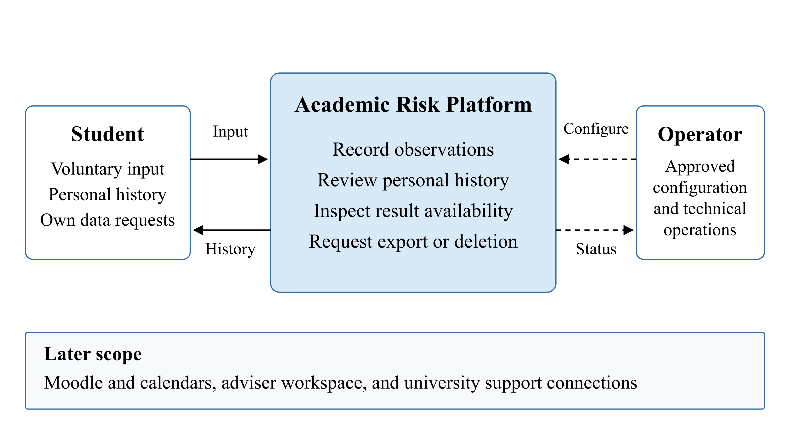

[Detailed views and editable sources](../../diagrams/README.md).

## Use cases

UC-01 covers input and validation; UC-02 covers personal history; UC-03 covers an estimate and its explanation when available; UC-04 covers export and deletion requests. Cancellation must leave records unchanged, unavailable estimates must have no score, and accepting a data request must not imply completion.

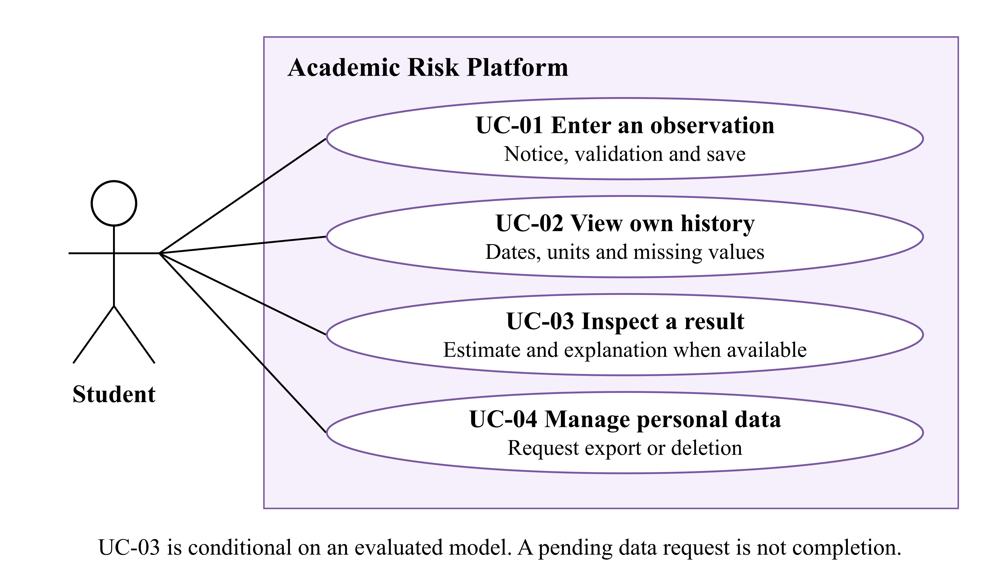

[Use case source](../../diagrams/sources/use_cases.json).

## Components and processing

We propose one FastAPI backend with modules for access, observations, estimation, explanation and data requests. React handles presentation; PostgreSQL stores owned records and provenance. The estimation adapter checks availability before model specific input sufficiency. It runs bounded inference against a fixed snapshot. An explanation uses that same model and snapshot; its failure is reported separately from a valid estimate.

The data request module records the requested scope and actual processing state. A download requires an owned, completed, unexpired export. Deletion must cover the agreed source and derived records, with a documented backup policy. Training and model evaluation run outside student requests.

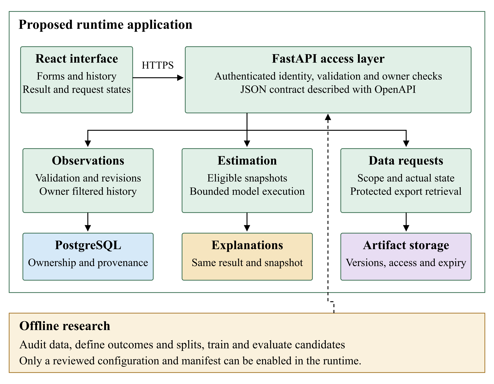

[Component source](../../diagrams/sources/components.json).

## Records and API

The [editable data design](../../diagrams/report/data-model.svg) contains six main entities. Accounts own observation revisions and data requests. A computed estimate refers to an input snapshot and trusted model manifest. Revisions preserve corrections without changing an earlier input snapshot. Missing scores remain absent, rather than being stored as zero.

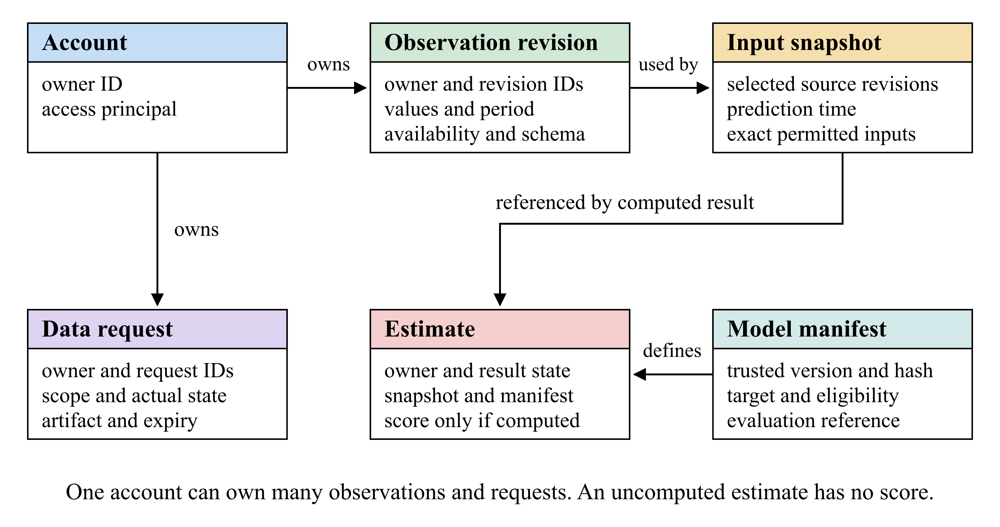

Predictors must have been available by the prediction time. For manual input, the receipt time establishes availability even if the student describes an earlier week. Known future deadlines can be included only when they had already been announced. Future outcome measurements belong to the separate research process.

| Method and route | Proposed behaviour |
| --- | --- |
| `POST /observations` | Validate and save an owner-bound observation revision. |
| `GET /observations` | Paginated own history only. |
| `GET /observations/{id}` | Read an authorised observation with explicit revision context. |
| `POST /observations/{id}/estimates` | Resolve an authorised revision and request estimation; persist the resulting domain state when processing succeeds. |
| `GET /estimates/{id}` | Read an owned estimate, its input/version context, and explanation status. |
| `POST /data-requests` | Register an owned export/deletion request; do not claim completion. |
| `GET /data-requests/{id}` | Read the owner's actual request status. |
| `GET /data-requests/{id}/download` | Serve only an authorised, completed, unexpired export; a request ID alone grants no access. |

The proposed retry contract ties each idempotency key to the owner, operation and content. A repeated key and content returns the same identifier; changed content conflicts. Creation and key mapping must be atomic. Replay windows and estimation retries remain to be specified.

The states are `model_unavailable`, `insufficient_data` and `available`; only the last may contain a score. Authentication, validation, storage and execution failures are safe errors. Explanation failure preserves a valid estimate. The executable API contract remains to be implemented.

# 8 UX Prototype

## Prototype and interaction

The [interactive prototype](https://aruzhanimm.github.io/academic-risk-platform/) uses HTML, CSS and JavaScript. The [source and local launch instructions](../../prototypes/README.md) remain available in the repository. It runs with labelled sample records held in browser memory. Reloading resets additions. It has no account system, backend, persistent storage, network data submission or trained model.

The input screen asks for an observation date, optional study hours during the preceding seven days and optional known deadlines for the following fourteen days. Hours may contain fractions; deadlines are whole numbers. The demo limits are 0 to 168 hours and 0 to 100 deadlines. These are input limits, not validated burnout thresholds. Blank fields are stored as missing and shown as “Not provided”; zero remains a valid number.

History shows dated records, units, a filter and a study hours chart. The chart describes sample workload, not burnout. The result screen defaults to `model_unavailable`; a separately labelled `insufficient_data` preview lets us review another message. That preview does not evaluate the entered values. The data screen simulates a pending export or deletion request without performing either operation.

## Screens

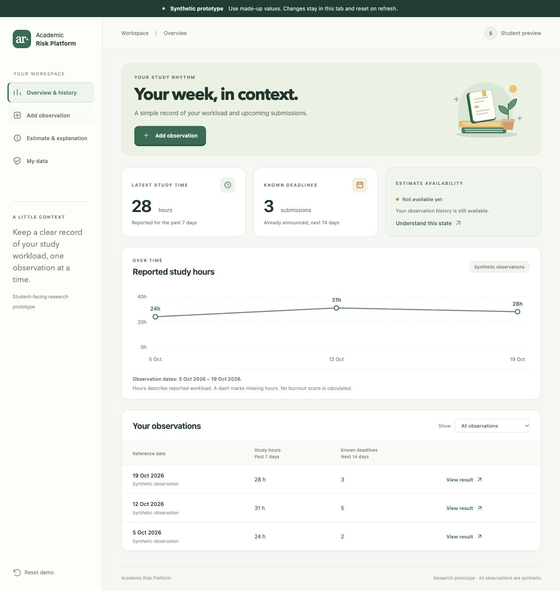

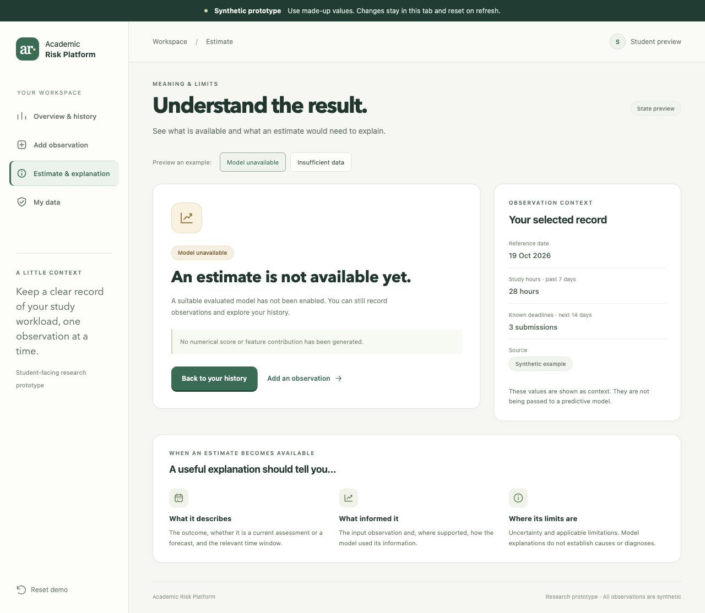

The interview notes prompted the revised message: "No prediction model is connected." It explains that adding observations will not enable a prediction in this prototype and that an unavailable estimate does not mean low or zero risk. Participant understanding of this revision has not yet been retested.

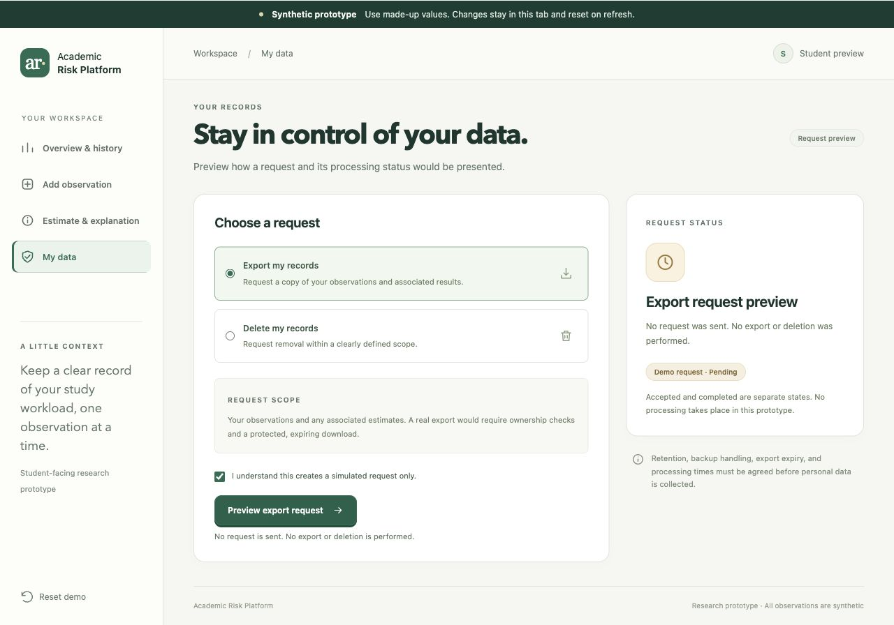

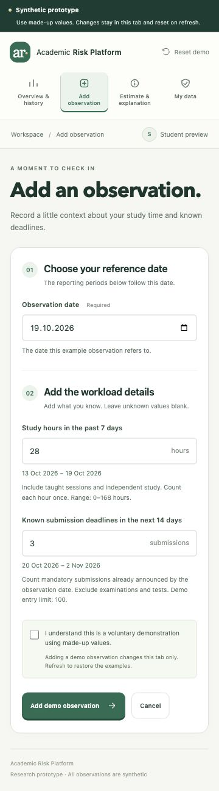

## Coverage and walkthrough

The prototype supports reviewing the notice, browser validation, history layout, unavailable states and request wording. Server validation, ownership, persistence, real exports and deletion remain implementation work. FR-004 requires a suitable evaluated model before a computed result can be accepted.

The planned walkthrough asks a participant to identify the demo's purpose, correct an invalid value, add a sample observation, find the latest record, explain an unavailable estimate and interpret a pending deletion request. Keyboard use and a narrow viewport will also be checked. We will record completion with or without assistance, errors and the participant's own explanation. Section 2 records the available user evidence. A systematic task-success and accessibility evaluation remains planned; Section 9 defines technical acceptance.

# 9 Verification and Evaluation Plan

## Research design and readiness

We will evaluate software behaviour, prediction and user understanding separately. The dataset descriptions reviewed so far do not establish a suitable longitudinal burnout sample. Before training, we need a permitted dataset with linked repeated observations, an agreed instrument and language, a future outcome, a horizon and a justified number of independent students. Cross sectional data would require a revised current assessment question.

Before looking at the final test set, we will record eligibility, the intended population, split rules, primary metric, weights, baselines, tuning budget, uncertainty method and practical acceptance criteria. Model enablement will need a separate review of applicability, software acceptance and interpretation. Completing an experiment alone does not make a model suitable for student use.

## Time and data separation

The [editable forecasting timeline](../../diagrams/report/time-design.svg) shows why each example needs a student key, prediction time t, horizon h, input snapshot, outcome window and availability timestamps. Inputs must satisfy `feature.available_at <= t`. At a simulated deployment cutoff c, training labels must satisfy `label.available_at <= c`. A later answer can still describe an earlier period, so the outcome recall window must be checked.

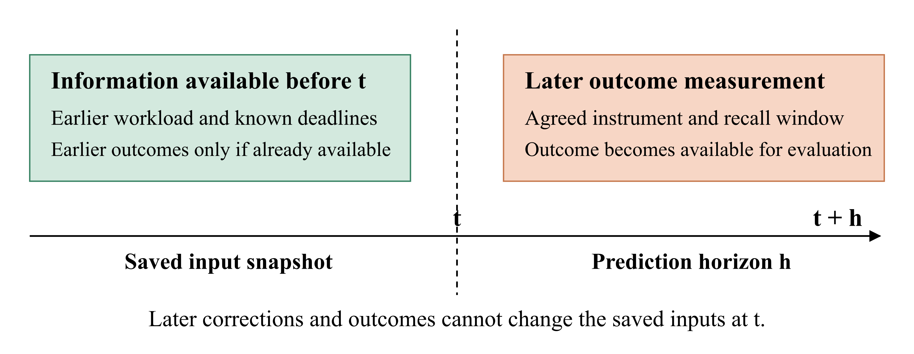

| Intended claim | Required separation |
| --- | --- |
| New students | Students are disjoint across development and test data, including inner folds. |
| Future periods for known students | Chronological cutoffs and only previously available information; students may recur. |
| New students in a future period | Both student separation and time ordering, also within development folds. |

We will check duplicate records, reused outcomes and windows crossing split boundaries. Overlaps that leak information will be excluded under a fixed rule; any embargo must follow actual windows and reporting delays. Calendar overlap between independent students is not itself leakage. Random row splitting is insufficient for the intended forecasting claim.

Imputation, scaling, encoding, feature selection, resampling, calibration and threshold tuning will use training folds or development data only. An outcome's own scoring items cannot reconstruct that same outcome as supposed prediction. An earlier measured outcome may be a declared predictor if its age and availability are recorded. Missing future outcomes remain unobserved labels; we will report follow up loss and comparison coverage.

## Baselines and metrics

For a continuous outcome, we propose a constant baseline, a regularised linear model and one justified nonlinear candidate. The MAE baseline uses the student weighted training median; squared error comparisons use the weighted training mean. Training weights are 1/n_s_train within each training partition. A persistence baseline is added only where a prior score was already available. Paired comparisons use the same eligible records.

Our proposed primary metric is student weighted mean absolute error. First calculate each student's mean absolute error, then average those values across S evaluable students. This gives every student equal total weight. Student weighted RMSE is the square root of the average of the students' mean squared errors. It is not the average of their individual RMSE values. We will also report pooled record MAE, the instrument units and range, student and record counts, exclusions and eligible coverage.

A binary endpoint requires a justified threshold and positive class fixed before testing. We would compare a student weighted training prevalence baseline, logistic regression and a nonlinear candidate. Average Precision would be the primary ranking measure, with ROC-AUC secondary. AP uses the sum of increases in recall multiplied by precision, not trapezoidal area under the precision recall curve. Metrics use weights proportional to 1/n_s; individual students' AP values are not averaged. Undefined one class cases will be identified.

Any operating threshold will be chosen on development data. At that threshold we will report sensitivity, specificity, positive predictive value and the confusion matrix. Brier score will be accompanied by a reliability diagram with fixed bins and counts, since Brier score alone does not isolate calibration error. Weighted quantities will be distinguished from raw counts.

## Uncertainty and explanation checks

We propose 95% percentile intervals from 2,000 student cluster bootstrap draws with a recorded seed. Each selected student contributes all eligible observations and paired candidate and baseline predictions. Repeat selections count as separate cluster copies. Candidate minus baseline differences are recomputed within each draw; endpoints from separate intervals are not subtracted.

All scheduled draws will be retained, with invalid counts and reasons reported. A metric with undefined draws will not receive the standard percentile interval. An interval conditional on valid draws would need a separate, predeclared exploratory interpretation. Small or unstable samples limit conclusions. This analysis concerns the test sample and does not capture training variability or transfer to another university. Practical usefulness and acceptable calibration and coverage must be specified before final testing.

For explanations, we will retain the model version, output scale, permitted training background data, feature mapping and method settings. Checks cover reproducibility and any claimed additive reconstruction within a stated tolerance. Contributions on a log odds scale will not be called percentage point changes in probability. Dependent features and plausible input changes require review; attributions describe model behaviour, not causes of burnout.

Error analysis will include failures, extreme errors, missing input patterns and cases with previous measurements. Feature group ablations will use the same cases, splits and tuning budget. Small subgroup summaries remain descriptive and must avoid identifying participants. We will preserve the frozen configuration and all planned comparisons, including negative findings.

## Software acceptance checks

The checks below are planned. The static prototype can demonstrate selected presentation states, but cannot pass server, storage or ownership acceptance. Synthetic fixtures will be used in an isolated environment.

| Check and trace | Procedure and expected evidence |
| --- | --- |
| REQ-V01, FR-001 | Cancel and submit separately; reopen the notice. Cancellation saves nothing; a real save retains the notice version. |
| REQ-V02, FR-002 | Exercise valid, malformed, missing, out of range and unsupported schema inputs, then retry. Invalid input has field errors and no partial write; a valid retry has no unintended duplicate. |
| REQ-V03, FR-003 | Inspect empty history, three dated records and all pages of a fixed dataset. Verify order, units, missingness and complete record sets. |
| REQ-V04, NFR-001 | Test anonymous, A and B sessions over lists, direct IDs, forged owner fields, results, requests and downloads. Only the owner accesses private content. Test optional RLS with the actual role and pool. |
| REQ-V05, FR-004 | Use a labelled estimator fixture to inspect target, units, snapshot, timestamps, horizon, model and schema versions. This verifies presentation only. |
| REQ-V06, FR-005 and NFR-006 | Exercise unavailable model, insufficient input, inference failure and explanation failure. Check availability first; unavailable states contain no score. An explanation failure preserves a valid result with a clear limitation. |
| REQ-V07, FR-006 and NFR-002 | Test pending, complete, failed, duplicate and expired requests with two users. Check actual operation scope, ownership, artifact expiry, derived records and backup handling. |
| REQ-V08, NFR-002 and NFR-006 | Inspect fields, retention, exports, logs, errors and repository contents. No unnecessary personal data, raw answers or credentials should appear. |
| REQ-V09, NFR-003 | Correct an input and add a later outcome after a fixture estimate. The past snapshot stays unchanged and reproduces the result within the declared tolerance. |
| REQ-V10, NFR-004 | Check all four flows by keyboard and at 360 CSS pixels. Verify focus, labels, textual errors and meaning independent of colour. |
| REQ-V11, NFR-005 | Measure the saving and history workload described below. Retain p95, failures and environment details for each operation type. |
| REQ-V12, NFR-006 | Inject storage and network failures, retry, switch accounts and reject unsupported artifact references. Verify no partial writes, duplicates, stale private caches or unsafe errors. |

REQ-V11 uses ten concurrent authenticated synthetic sessions and an initial 1,000 observations. For saving and history separately, collect 1,000 valid operations after 100 warm up operations. Measure server elapsed time with a monotonic clock from request entry to response completion. The provisional Should target is p95 no greater than two seconds, with no unexpected server errors. Report failures and timeouts separately. Record hardware, software versions, payloads, request mix, concurrency, starting and ending record counts and growth during saves. Inference and data request processing are measured separately.

## Walkthrough and reproducibility

The walkthrough in Section 8 records actual participant count, recruitment, prototype revision, browser, viewport, input method, assistance and observed interpretation. In particular, we will check whether missing differs from zero, unavailable differs from low risk, and pending differs from completed deletion. Counts will include denominators. Any timing measure needs defined start and stop rules.

Each technical check or experiment will retain its ID, executor and actual date; dataset or fixture version; inclusion rules; student and record counts; code and environment versions; seed and split manifest; model, calibration and threshold settings; expected and actual observations; uncertainty; and review decision. Private data remain under access controls. Public outputs contain aggregates, procedures and redacted evidence.

Aruzhan maintains the research protocol and metrics, Vitaliy coordinates technical acceptance, and Saniya coordinates measurement review and walkthroughs. Each executed result will identify its actual executor and reviewer.

The [full evaluation plan](../../docs/09_verification_evaluation.md) retains detailed procedures. Official references are [cross validation](https://scikit-learn.org/stable/modules/cross_validation.html), [data leakage](https://scikit-learn.org/stable/common_pitfalls.html#data-leakage), [Average Precision](https://scikit-learn.org/stable/modules/generated/sklearn.metrics.average_precision_score.html) and [probability calibration](https://scikit-learn.org/stable/modules/calibration.html). The weighting and bootstrap settings above are proposed project choices, not completed results.

# 10 Project Management and Risks

## Responsibilities and delivery

The repository contains research and design documents, the synthetic interaction prototype, evaluation procedures and management records. Published PRs 1 to 8 establish the earlier deliverables. The current submission incorporates user evidence and the supervisor response in Section 11; substantive peer review remains open.

| Member | Coordinating responsibility | Delivery references |
| --- | --- | --- |
| Aruzhan Kartam | Proposal, research and evaluation design, management, supervisor feedback and submission assembly. | Repository foundation, [PR 6](https://github.com/aruzhanimm/academic-risk-platform/pull/6), [PR 7](https://github.com/aruzhanimm/academic-risk-platform/pull/7) and [PR 8](https://github.com/aruzhanimm/academic-risk-platform/pull/8). |
| Vitaliy Golubenko | Technology, requirements, architecture, technical verification, access and review coordination. Interviewer for the five supplied interview records. | [PR 3](https://github.com/aruzhanimm/academic-risk-platform/pull/3), [PR 4](https://github.com/aruzhanimm/academic-risk-platform/pull/4) and the evidence record in Section 2. |
| Saniya Yerzhan | Literature, measurement, system comparison, UX, user-evidence synthesis and interpretation. | [PR 1](https://github.com/aruzhanimm/academic-risk-platform/pull/1), [PR 2](https://github.com/aruzhanimm/academic-risk-platform/pull/2) and [PR 5](https://github.com/aruzhanimm/academic-risk-platform/pull/5). |

Vitaliy coordinates cross-review, while another member reviews his contributions. A merged publication does not by itself establish approval, successful user testing or model validity. Actual review records identify the reviewer, comments and resulting changes.

## Task tracking and remaining gates

The [YouTrack board](https://academic-risk-platform.youtrack.cloud/agiles/204-1/218-1) and [issue list](https://academic-risk-platform.youtrack.cloud/issues/ARP) track fourteen first-period tasks with owners, priorities, due dates, acceptance criteria and delivery links. Three next-stage tasks add feasibility (ARP-16, Aruzhan, Critical), the application slice (ARP-17, Vitaliy, Major) and the data audit/protocol (ARP-18, Aruzhan, Major). All three are To do without due dates because the next review date is unspecified. The [task register](../../docs/10_project_management/task_register.md) maps the seventeen tasks; the table below summarises first-period evidence.

| Issues | Scope | Evidence position |
| --- | --- | --- |
| [ARP-2 to ARP-10](https://academic-risk-platform.youtrack.cloud/issues/ARP) | Foundation, literature, systems, technologies, requirements, architecture, UX, evaluation, proposal and management. | Reviewable deliverables published in the repository; final report links use the submission tag. |
| [ARP-11](https://academic-risk-platform.youtrack.cloud/issue/ARP-11) | User needs and their implications for requirements. | Nine questionnaire submissions and five interview records are synthesised in Section 2, with provenance limitations and follow-up decisions. |
| [ARP-12](https://academic-risk-platform.youtrack.cloud/issue/ARP-12) | Supervisor feedback and resulting changes. | Eight comments were supplied on 24 October. Section 11 records responses and open next-stage actions. |
| [ARP-13](https://academic-risk-platform.youtrack.cloud/issue/ARP-13) | Cross-document peer review. | Reviewer comments, corrections and resolution evidence remain to be recorded. |
| [ARP-14](https://academic-risk-platform.youtrack.cloud/issue/ARP-14) | Prototype and repository access for reviewers. | Public prototype and repository access checks are recorded. Live YouTrack access requires an account; its evidence PDF is provided. |
| [ARP-15](https://academic-risk-platform.youtrack.cloud/issue/ARP-15) | Final PDFs, repository tag and form. | This eleven-section report, a separate YouTrack evidence PDF and the form must refer to one reviewed repository revision. |

Task due dates through 20 October follow recorded commit-date references. Issue creation, work, review and publication timestamps are separate records. The live issues hold current states; the report does not treat an issue status as a substitute for its acceptance evidence.

## Submission sequence and dependencies

The submission deadline is 24 October 2026, 18:00 Astana time. First reconcile the user findings, peer review and supervisor-feedback status with the source documents. Then check the hosted prototype, repository and editable-diagram access; freeze the source revision; and produce matching report and task-evidence PDFs. The tag is [prob-period-1](https://github.com/aruzhanimm/academic-risk-platform/tree/prob-period-1). Its direct link identifies the submitted source snapshot.

| Gate | Required input | Evidence for completion |
| --- | --- | --- |
| Content and review | Research, requirements, prototype, user evidence and actual comments. | Consistent documents, recorded decisions, resolved changes and explicit remaining limitations. |
| Viewer access | Hosted prototype, source repository and supporting materials. | Successful checks under the intended committee access conditions. |
| Package consistency | One frozen source revision and reconciled task evidence. | Tag, links and PDFs describe the same materials. Main report at most 100 MB; task-evidence PDF at most 10 MB. |
| Form submission | Verified team details, accessible links, final PDFs and confirmed closing time. | Correct form entries, both uploads and retained submission confirmation. |

Later implementation depends on an agreed measurement/data protocol, secure persistence and ownership, and technical acceptance. Research experiments additionally require temporally suitable data and a frozen evaluation design. Model enablement follows a separate applicability review.

## Principal risks

| Risk | Likelihood and impact | Owner and response |
| --- | --- | --- |
| User evidence is overinterpreted or loses its provenance. | Medium / High | Saniya and Vitaliy. Retain the small convenience-sample limits, unconfirmed interview metadata and permitted wording; link findings to proposed changes. |
| Supervisor actions or peer review remain incomplete. | High / High | Aruzhan and Vitaliy. Address the recorded comments and retain actual review evidence; keep outstanding actions visible. |
| Available data cannot support future burnout prediction. | High / High | Aruzhan and Saniya. Resolve outcome, instrument, permissions, linkage and horizon before training; revise the research question when necessary. |
| Information leaks across research partitions. | Medium / High | Aruzhan. Audit availability times, repeated students, outcome reuse, overlapping windows and training-only transformations. |
| Personal data precede verified access and lifecycle controls. | Medium / High | Vitaliy. Keep the prototype synthetic; test ownership, logs, retention, export and deletion before a pilot. |
| Report, tag, evidence or reviewer access disagree. | Medium / High | Aruzhan and Vitaliy. Reconcile one source revision, verify viewer access and recheck both PDFs before uploading. |

The [full risk register](../../docs/10_project_management/risks.md) identifies triggers, mitigation and closure evidence. No predictive performance or completed personal-data pilot is claimed by this submission.

# 11 Supervisor Feedback

## Feedback received

Akbota Rakym's feedback was supplied through the team representative on 24 October 2026. The writing date and exact reviewed revision are unconfirmed; the supplied page references concern that earlier report. The supervisor described a strong research and design submission, particularly the literature, testable requirements and distinction between workload, burnout measurement and demonstration data. The main concern is prediction feasibility.

The supervisor did not independently verify repository activity, prototype execution, interviews or experiments. This response records current evidence and planned changes; it does not claim approval of implementation or results. The [full response register](../../docs/11_supervisor_feedback.md) tracks the actions through [ARP-12](https://academic-risk-platform.youtrack.cloud/issue/ARP-12).

## Comments and responses

Priorities follow the supplied feedback. All remaining actions below are open.

| Comment and priority | Current evidence | Response before the next review |
| --- | --- | --- |
| **1. Prediction feasibility and scope: Critical** | The dataset audit has not established a suitable longitudinal burnout dataset. Outcome, instrument and horizon remain unresolved. | Choose overload or burnout, instrument/version, language, scoring and horizon. Verify legal/ethical access and repeated measurements. Record a supported feasibility decision and fallback scope. |
| **2. User research: High** | The current Section 2 contains five interview records and nine questionnaire submissions. Session metadata and some interpretations remain open. | Confirm available metadata, conduct follow-up walkthroughs and link findings to requirement changes or reasons for no change. Existing notes are not five successful standardised tests. |
| **3. Research and evaluation: High** | Section 9 separates assessment from forecasting and proposes conditional splits, metrics and leakage controls. No record-level audit or model result is reported. | After defining the outcome and data, freeze population, temporal split, baselines, primary metric and practical criteria. Run a reproducible audit of permitted records, availability times and label independence. |
| **4. Implementation evidence: High** | The prototype remains synthetic and memory-only. React, FastAPI, PostgreSQL, authentication and persistence are proposed. | Build and demonstrate authenticated input, server validation, owned storage and history. Retain positive, ownership-denial and failure/retry test evidence for REQ-V02, V03, V04 and V12. |
| **5. Privacy and responsible use: High** | FR-001/006 and NFR-001/002/006 define notice, ownership and lifecycle conditions. Exploratory interviews do not establish permission for a data pilot. | Before collection, document consent, minimisation, retention, deletion, access and institutional permissions. Keep non-diagnostic wording, no unsupported risk scores and no automatic staff disclosure. |
| **6. Architecture and API: Medium** | Section 7 describes routes and boundaries; an executable OpenAPI contract is not delivered. | Validate a contract covering authentication, errors, idempotency and lifecycle. Check model availability before model-specific sufficiency; distinguish execution failures and return no score for unavailable/insufficient states. |
| **7. UX validation: Medium** | Result wording was revised after recorded ambiguity, then browser-checked. Participant understanding was not retested; a 500-pixel check does not meet the 360-pixel target. | Observe missing versus zero, unavailable versus low risk, and pending versus completed. Record assistance, explanations and shown revision; verify corrections and NFR-004/REQ-V10. |
| **8. GitHub, YouTrack and traceability: Medium** | The task register links owners and delivery evidence. Public-access checks and a YouTrack evidence PDF exist; substantive peer review remains open. | Retain meaningful reviewer comments and resolutions, issue-to-requirement/test/commit links and accessible final artifacts. Reconcile the response register, PDFs and submission tag, then recheck changed artifacts. |

## Five deliverables for the next review

The next review date is unspecified. These deliverables remain open; the present documents provide inputs.

1. **Data and outcome feasibility decision:** measurement specification, permitted temporal data, justified horizon or fallback. Aruzhan coordinates, with Saniya for measurement. [ARP-16](https://academic-risk-platform.youtrack.cloud/issue/ARP-16).
2. **Interview findings and revised requirements:** supported metadata, finding-to-change links and actual follow-up observations. Saniya coordinates, with Vitaliy for session evidence. [ARP-11](https://academic-risk-platform.youtrack.cloud/issue/ARP-11).
3. **Working, tested application slice:** authenticated input, validation, owned persistence, history and an executable API contract. Vitaliy coordinates. [ARP-17](https://academic-risk-platform.youtrack.cloud/issue/ARP-17).
4. **Reproducible research/verification record:** permitted-data audit, conditional protocol, configurations and actual expected/observed checks. Aruzhan coordinates research, Vitaliy software checks and Saniya UX. [ARP-18](https://academic-risk-platform.youtrack.cloud/issue/ARP-18).
5. **GitHub/YouTrack evidence and comment responses:** accessible reviewed revision, actual owners/states, substantive review records and traceable changes. Aruzhan consolidates evidence supplied by all members. [ARP-13](https://academic-risk-platform.youtrack.cloud/issue/ARP-13), [ARP-15](https://academic-risk-platform.youtrack.cloud/issue/ARP-15).
